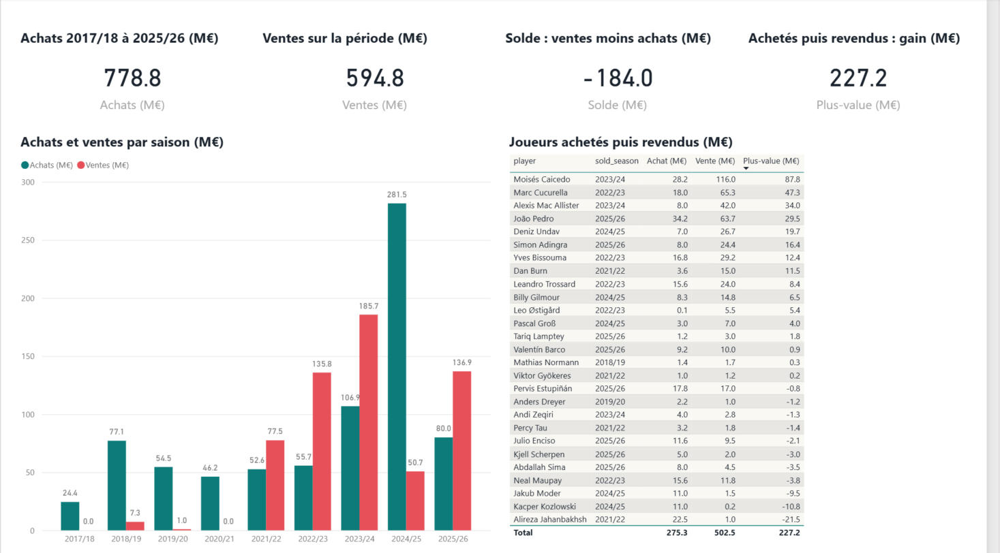

# Brighton : ce que disent les données

Un pipeline en Python (bibliothèque standard uniquement) avec contrôles qualité, et un rapport Power BI généré par script.

- **Matchs :** Premier League, 2017/18 à 2026/27 (en cours, jusqu'au 23/11/2026), 3 530 matchs, une ligne par équipe et par match.
  Source : [football-data.co.uk](https://www.football-data.co.uk).
- **Transferts de Brighton :** saisons complètes 2017/18 à 2025/26.
  Source : [transfermarkt-datasets](https://github.com/dcaribou/transfermarkt-datasets) (dépôt CC0, données Transfermarkt, jusqu'au 06/07/2026).

Les fichiers de données ne sont pas redistribués ici. Vérifier les conditions des sources avant tout autre usage.

## Lancer le projet

Python 3.10 ou plus, aucune dépendance à installer.

```bash
python src/download.py          # data/raw et data/raw_transfers
python src/pipeline.py          # matchs : contrôles qualité, puis data/out
python src/transfers.py         # transferts : contrôles qualité, puis data/out
python powerbi/build_pbip.py    # modèle et rapport Power BI
```

Ouvrir `powerbi/Brighton.pbip` dans Power BI Desktop puis **Actualiser**.
Après un clonage ou un déplacement du dossier, relancer `build_pbip.py` : le chemin des données est le paramètre `DataFolder`.

## Contrôles qualité

Matchs :
- **Bloquants :** statistique manquante, date invalide, affiche en double, résultat contraire au score, saison terminée incomplète.
- **Quarantaine :** tirs cadrés supérieurs aux tirs (West Ham, 15/08/2021 : 9 cadrés pour 8 tirs). Le score est gardé, les tirs de ce match sont vidés.
- **Information :** buts supérieurs aux tirs cadrés (possible avec un but contre son camp).

Transferts :
- **Bloquants :** date invalide, montant négatif ou non numérique, transfert en double.
- **Exclus :** transferts datés après la date de l'extraction.
- **Information :** montant inconnu (non compté), montant nul (transfert libre ou prêt).

## Limites

- Matchs : résultats et tirs. Les xG ne sont renseignés que pour 2026/27 et ne sont pas utilisés. La saison en cours ne compte que 11 matchs.
- Transferts : montants en euros. Un gain associe une vente payante au dernier achat payant antérieur du même joueur.
- **Écart entre sources, non corrigé :** achat de Caicedo à 28,2 M€ dans la base, environ 4,5 M£ dans la presse.
- Ces données décrivent des résultats et des transferts, pas les méthodes de recrutement du club.

## Le rapport



