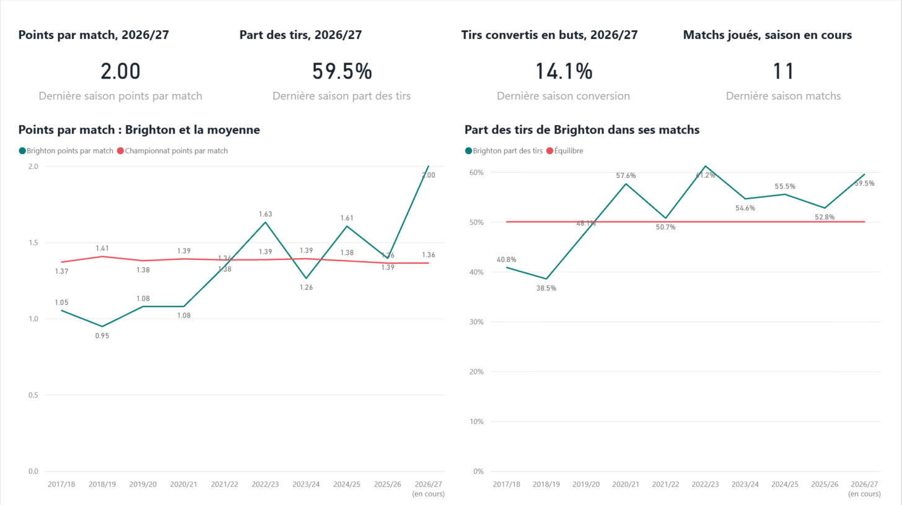

# Brighton : ce que disent les données de matchs

Premier League, saisons 2017/18 à 2026/27 (en cours, matchs jusqu'au 23/11/2026) : 3 530 matchs, une ligne par équipe et par match.
Données : [football-data.co.uk](https://www.football-data.co.uk). Les fichiers bruts ne sont pas redistribués ici (conditions à vérifier avant tout autre usage).

```bash
node src/download.js        # data/raw
node src/pipeline.js        # contrôles qualité, puis data/out
node powerbi/build_pbip.js  # modèle et rapport Power BI
```

Ouvrir `powerbi/Brighton.pbip` dans Power BI Desktop puis Actualiser. Sans dépendance : Node 18 ou plus.
Après un déplacement du dossier, relancer `build_pbip.js` (le chemin des données est un paramètre `DataFolder`).

## Contrôles qualité

- **Bloquants :** statistique manquante, date invalide, affiche en double, résultat contraire au score, saison terminée incomplète.
- **Quarantaine :** tirs cadrés supérieurs aux tirs (West Ham, 15/08/2021 : 9 cadrés pour 8 tirs). Le score est gardé, les tirs de ce match sont vidés.
- **Information :** buts supérieurs aux tirs cadrés (possible avec un but contre son camp).

## Limites

Résultats et tirs uniquement : ni joueurs, ni transferts. Les xG ne sont renseignés que pour 2026/27 et ne sont pas utilisés dans le rapport.
Ces données décrivent les résultats de Brighton, pas ses méthodes de recrutement. La saison en cours ne compte que 11 matchs.




