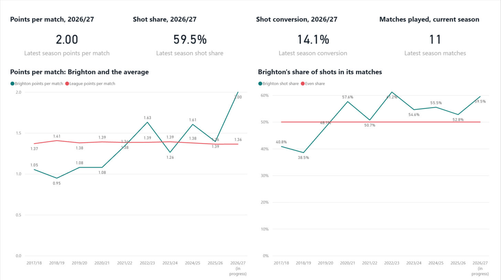
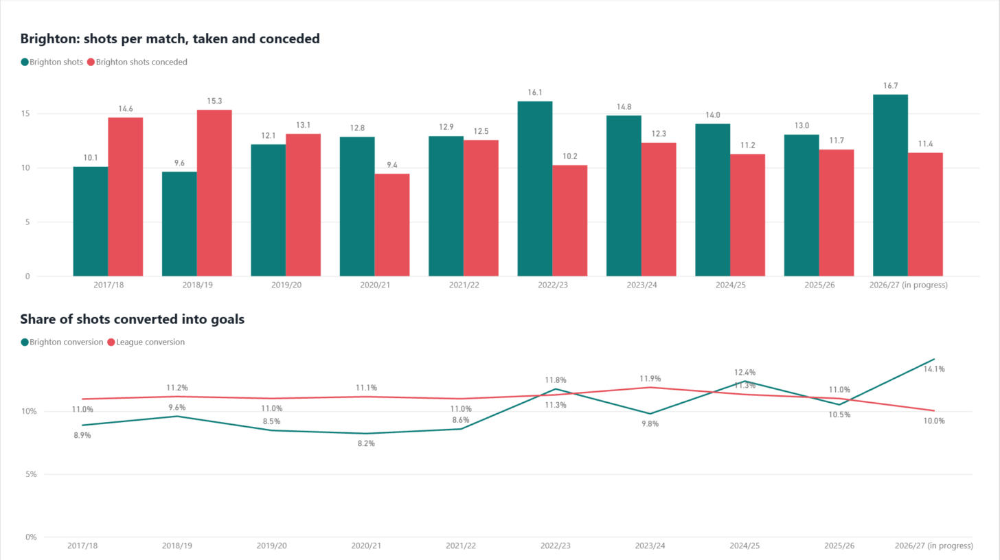
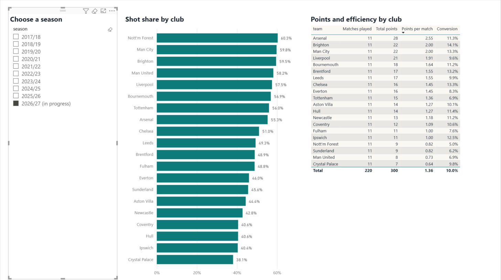

# Brighton: what the data says

A Python pipeline (standard library only) with data quality checks, and a Power BI report generated by script.

- **Matches:** Premier League, 2017/18 to 2026/27 (in progress, up to 23 November 2026), 3,530 matches, one row per team and per match.
  Source: [football-data.co.uk](https://www.football-data.co.uk).
- **Brighton transfers:** complete seasons 2017/18 to 2025/26.
  Source: [transfermarkt-datasets](https://github.com/dcaribou/transfermarkt-datasets) (CC0 repository, Transfermarkt data, up to 6 July 2026).

Data files are not redistributed here. Check the sources' terms before any other use.

## Run it

Python 3.10 or later, nothing to install.

```bash
python src/download.py          # data/raw and data/raw_transfers
python src/pipeline.py          # matches: quality checks, then data/out
python src/transfers.py         # transfers: quality checks, then data/out
python powerbi/build_pbip.py    # Power BI model and report
```

Open `powerbi/Brighton.pbip` in Power BI Desktop and click **Refresh**.
After cloning or moving the folder, run `build_pbip.py` again: the data path is the `DataFolder` parameter.

## Quality checks

Matches:
- **Blocking:** missing statistic, invalid date, duplicate fixture, result contradicting the score, incomplete finished season.
- **Quarantine:** more shots on target than shots (West Ham, 15 August 2021: 9 on target out of 8). The score is kept, the shot statistics of that match are blanked.
- **Info:** more goals than shots on target (possible with an own goal).

Transfers:
- **Blocking:** invalid date, negative or non-numeric fee, duplicate transfer.
- **Excluded:** transfers dated after the snapshot.
- **Info:** unknown fee (not counted), zero fee (free transfer or loan).

## When sources disagree

No source wins by default. The one closest to the original data is preferred, the other stays visible, with the currency,
add-ons and calculation method stated. Sources that measure different things are shown separately.

Open gap: Caicedo's purchase fee is €28.2M in the database and about £4.5M in the press. Neither is an official figure.
The calculations keep the database value; nothing was edited by hand. The database has no field for add-ons.

## Limits

- Matches: results and shots. xG is only filled for 2026/27 and is not used. The current season has only 11 matches.
- Transfers: fees in euros. A gain pairs a paid sale with the latest earlier paid purchase of the same player.
- These data describe results and transfers, not the club's recruitment methods.

## The report





